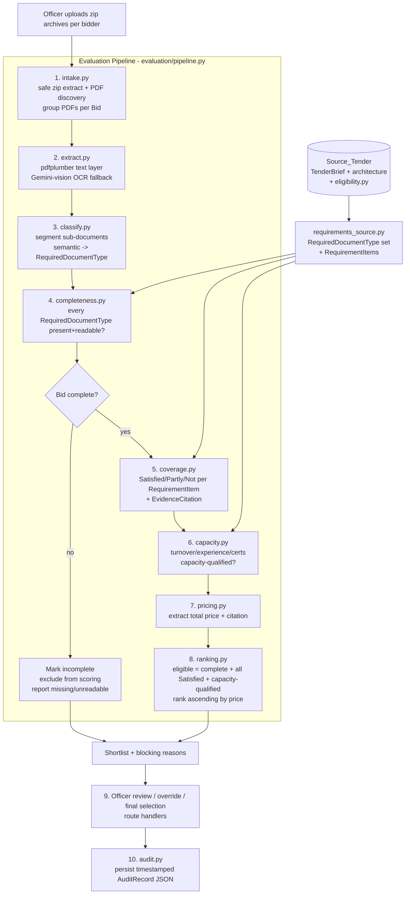

# Design Document

## Overview

Stage 3 (**Evaluation and Best-Match Recommendation**) is a new capability added to the existing AI-Powered Tender Document Builder. Stages 1 and 2 collect requirements and generate an issued tender from a single approved `TenderBrief`/`architecture`. Stage 3 begins once bidders submit external bids in response to that issued tender, and it does three things end to end:

1. **Document completeness check** — confirm every required document is present, readable, and valid in each bid, and hold back incomplete bids from scoring.
2. **Requirement coverage check** — assess each complete bid against the eligibility, technical, qualification, and capability requirements the tender specified, with cited evidence (filename + page) for every finding.
3. **Best-match selection** — among complete, fully compliant, capacity-qualified bids, recommend the cheapest, presented as a ranked shortlist the officer reviews, overrides, and finalizes.

The design follows the existing application's principles and mechanics exactly:

- **Single source of truth** — the issued `TenderBrief`, its approved `architecture`, and the fixed eligibility criteria in `eligibility.py` define what was required. The required-document set and requirement items are derived from these, never hand-maintained.
- **Human-in-the-loop** — the officer explicitly releases complete bids to scoring and confirms the final selection. Nothing is awarded automatically.
- **Grounded and explainable** — every completeness, coverage, capacity, and price finding cites a source filename and page number. OCR is done through the existing Gemini vision model, not a native OCR binary.
- **Pure-Python / no-native-dependency preference** — consistent with the `fpdf2` rationale already in the codebase, new dependencies must be pip-installable wheels with no OS binary requirement.
- **Content/semantic, not folder/filename based** — real bids arrive as zip archives with inconsistent folder layouts (see `extracted_1/` grouped by document type and `extracted_2/` grouped by bid part, both the same bidder). Classification uses document content only.

Stage 3 keeps the same server style as Stage 1/2: a single FastAPI app (`tender_app/app.py`) with an in-memory `STATE` dict, server-rendered HTML templates, vanilla JS, and `static/style.css`. No new frontend framework is introduced. The three Stage 3 screens (Bid Document Check, Bid Evaluation with evidence, Best Match Recommendation) are modeled on the product one-pager screenshots while reusing the existing two-panel / card / badge aesthetic.

### Research Notes

- **PDF text extraction**: `pdfplumber` is already used by the `tools/` scripts (`extract_pages.py`, `probe_bids.py`) but is **not** in `requirements.txt`. The design adds it. `pdfplumber` is a pure-Python wheel (it wraps `pdfminer.six`), consistent with the no-native-binary preference.
- **PDF → image rendering for OCR**: Gemini vision needs page images. `PyMuPDF` is fast but ships a bundled native library; `pypdfium2` ships a pip wheel (PDFium) with no system dependency and matches the project's pure-wheel preference. The design selects **`pypdfium2`** to render pages to PNG bytes for the vision call.
- **Gemini vision**: `config.LLM_MODEL = "gemini-2.5-flash"` is multimodal. `llm.py` currently only exposes single-shot text `generate(...)`. The design adds a multimodal helper `generate_multimodal(prompt, images, system, temperature)` that passes image bytes alongside text, used for OCR and for content classification/extraction prompts.
- **Sample data reality** (observed): bidder `ILIOSDIGITAL` appears in both `extracted_1/` and `extracted_2/`, under different folder conventions and filenames; certificates are frequently scanned images; single PDFs bundle many sub-documents (e.g. an 87-page PQ bundle). Multi-bidder ranking is in scope, but sample data has a single bidder, so the testing strategy includes a synthetic second bidder to exercise ranking.

## Architecture

Stage 3 is organized as a new package `tender_app/evaluation/` containing the pipeline stages as focused modules, new pydantic models for the evaluation domain, and new FastAPI routes plus a template and static assets for the three screens. The pipeline is a linear series of stages feeding one `EvaluationRun` object held in `STATE`, mirroring how Stage 1/2 hold a single `TenderBrief` in `STATE`.

### Package Layout

```
tender_app/
  app.py                     # existing; add Stage 3 routes under /api/eval/...
  llm.py                     # existing; add generate_multimodal(...)
  config.py                  # existing; add EVAL_DIR working directory
  eligibility.py             # existing; source of Required_Document_Types + eligibility items
  models.py                  # existing TenderBrief/ArchitectureItem (unchanged)
  evaluation/
    __init__.py
    models.py                # Stage 3 pydantic models (see Data Models)
    requirements_source.py   # derive RequiredDocumentType set + RequirementItems from Source_Tender
    intake.py                # (1) safe zip extraction, PDF discovery, bid grouping
    extract.py               # (2) pdfplumber text + Gemini-vision OCR fallback
    classify.py              # (3) sub-document segmentation + semantic classification
    completeness.py          # (4) completeness gate
    coverage.py              # (5) requirement coverage w/ evidence citations
    capacity.py              # (6) capacity assessment
    pricing.py               # (7) price extraction
    ranking.py               # (8) best-match ranking + shortlist
    audit.py                 # (10) persist/load Audit_Record (JSON)
    pipeline.py              # orchestrates stages 1-8 into an EvaluationRun
  templates/
    index.html               # existing Stage 1/2 UI
    evaluation.html          # NEW: the three Stage 3 screens (tabbed, one page)
  static/
    style.css                # existing; append Stage 3 matrix/panel styles
    app.js                   # existing Stage 1/2 JS
    evaluation.js            # NEW: Stage 3 screen logic (vanilla JS, fetch)
```

Officer review/override and final selection (Requirement 9) are not a pipeline stage; they are route handlers that mutate the in-memory `EvaluationRun` and append to the `AuditRecord`.

### Pipeline Flow



### Separation of Concerns

- **requirements_source.py** is the only module that reads the Source_Tender. It emits the `RequiredDocumentType` set (Requirement 3.3) and the `RequirementItem` list across the four classes (Requirement 5.1). Downstream stages consume these, keeping the single-source-of-truth principle intact.
- **extract.py** owns the pdfplumber-vs-OCR decision and records the extraction source per document (Requirement 2.4). No other stage calls the LLM for OCR.
- **classify.py**, **coverage.py**, **capacity.py**, **pricing.py** each build a focused prompt and call `llm.generate` or `llm.generate_multimodal`. They never do extraction or ranking.
- **ranking.py** is pure (deterministic function of the per-bid results); it makes no LLM calls, which keeps the best-match decision explainable and testable.

## Components and Interfaces

All functions live in `tender_app/evaluation/`. Types reference the Data Models section.

### requirements_source.py

```python
def required_document_types(tender: TenderBrief) -> list[RequiredDocumentType]:
    """Derive the Required_Document_Type set from eligibility.ELIGIBILITY_ROWS
    (documentary proofs column) plus any tender-specific required documents.
    Deterministic; no LLM. (Req 3.3)"""

def requirement_items(tender: TenderBrief) -> list[RequirementItem]:
    """Derive RequirementItems in four classes:
      - eligibility: from eligibility.ELIGIBILITY_ROWS (criterion column)
      - technical/qualification/capability: from tender.architecture + TenderBrief
    (Req 5.1)"""
```

### intake.py

```python
def extract_bid(archives: list[Path], bid_id: str, run_dir: Path) -> BidIntakeResult:
    """Safely extract all zip archives for one Bid into run_dir/bid_id/.
    - Rejects entries whose resolved path escapes the bid directory (zip-slip). (Req 1.6)
    - Treats multiple archives as one Bid. (Req 1.2)
    - Returns discovered PDF paths; filenames/folders are NOT used for meaning. (Req 1.3)
    - If no readable PDF found, result.evaluable = False. (Req 1.4)"""

def safe_extract_member(zf: ZipFile, member: ZipInfo, dest: Path) -> Path | None:
    """Resolve member path under dest; return None if it escapes (reject)."""
```

### extract.py

```python
def extract_document(pdf_path: Path) -> ExtractedDocument:
    """Per page: try pdfplumber text (Req 2.1). If a page yields no text or
    garbled/non-readable text, render it with pypdfium2 and OCR via Gemini
    vision (Req 2.2). Record per-document extraction source: TEXT | OCR | BOTH
    (Req 2.4). If neither yields readable text, mark page/document unreadable
    and keep the source filename (Req 2.5, 5-of-2)."""

def looks_unreadable(text: str) -> bool:
    """Heuristic: empty, whitespace-only, or high ratio of non-printable/
    replacement glyphs -> treat as needing OCR."""
```

### classify.py

```python
def classify_bid(doc: list[ExtractedDocument],
                 types: list[RequiredDocumentType]) -> list[SubDocument]:
    """Segment each PDF into Sub_Documents (page ranges) and assign each to a
    RequiredDocumentType by content via Gemini (Req 3.1, 3.2).
    - Records source filename + page range per Sub_Document (Req 3.4).
    - Unmatched -> classification='Unclassified', retained for review (Req 3.5).
    - Multiple Sub_Documents of the same type all associate to that type (Req 3.6)."""
```

### completeness.py

```python
def check_completeness(sub_docs: list[SubDocument],
                       types: list[RequiredDocumentType]) -> CompletenessResult:
    """For each RequiredDocumentType, is there >=1 present AND readable
    Sub_Document? (Req 4.1)
      - none present/readable -> MISSING (Req 4.2)
      - present but only unreadable -> PRESENT_BUT_UNREADABLE (Req 4.3)
    Any MISSING/UNREADABLE -> bid.complete = False, excluded from scoring (Req 4.4).
    All present+readable -> complete = True (Req 4.5).
    Result lists each missing/unreadable type with the bidder identity (Req 4.6)."""
```

### coverage.py

```python
def assess_coverage(sub_docs: list[SubDocument],
                    items: list[RequirementItem]) -> list[CoverageFinding]:
    """For each RequirementItem assign Satisfied | Partly | Not (Req 5.2).
    Satisfied/Partly MUST carry >=1 EvidenceCitation (filename+page) (Req 5.3).
    Not Satisfied MUST carry a reason (Req 5.4).
    Evidence is grounded in classified sub-documents; the LLM is asked to quote
    the supporting text and name its source doc/page."""
```

### capacity.py

```python
def assess_capacity(sub_docs: list[SubDocument],
                    tender: TenderBrief) -> CapacityResult:
    """Assess turnover, prior experience, delivered projects, certifications
    (Req 6.1). Turnover uses the CA/Statutory Auditor turnover certificate as
    evidence with a citation (Req 6.2). Meets all -> capacity_qualified=True
    (Req 6.3); otherwise record each unmet requirement + reason (Req 6.4)."""
```

### pricing.py

```python
def extract_price(sub_docs: list[SubDocument]) -> BidPrice:
    """Extract the total quoted price from the price schedule with a citation
    (Req 7.1, 7.2). If none extractable -> available=False, note that the bid
    cannot be ranked on price until the officer supplies it (Req 7.3)."""
```

### ranking.py (pure, no LLM)

```python
def build_shortlist(bids: list[BidEvaluation]) -> Shortlist:
    """Eligible = complete AND every RequirementItem Satisfied AND
    capacity_qualified (Req 8.1). Rank eligible bids ascending by price
    (Req 8.2); lowest-price eligible bid is best_match (Req 8.3). Record
    reasons (price, coverage, capacity) per ranked bid (Req 8.4). If none
    eligible, report that with per-bid blocking reasons (Req 8.5). Eligible
    bids with unavailable price are listed unranked-on-price (Req 8.6)."""
```

### audit.py

```python
def persist_run(run: EvaluationRun) -> Path:
    """Write a timestamped AuditRecord JSON to config.EVAL_DIR with a unique
    filename (Req 10.1, 10.3). Includes citations for coverage and price."""

def append_action(run: EvaluationRun, action: OfficerOverride | FinalSelection) -> None:
    """Append override/selection + justification + timestamp (Req 10.2)."""

def load_run(run_id: str) -> EvaluationRun:
    """Load a persisted AuditRecord for officer review (Req 10.4).
    Resolve within EVAL_DIR only (path-traversal safe, mirrors download())."""
```

### FastAPI Routes (added to app.py)

| Method & Path | Purpose | Requirements |
|---|---|---|
| `GET /evaluation` | Serve `evaluation.html` (three Stage 3 screens) | 9.1 |
| `POST /api/eval/bids` | Upload zip archives for a bidder (multipart) | 1.1, 1.2, 1.5 |
| `POST /api/eval/run` | Run intake→classify→completeness; return doc-check matrix | 1–4 |
| `GET /api/eval/completeness` | Bid Document Check matrix + summary tiles | 4.6 |
| `GET /api/eval/missing-report` | Download missing-documents report | 4.6 |
| `POST /api/eval/release` | Officer releases complete bids to scoring (coverage+capacity+pricing) | 4.5, 5–7 |
| `GET /api/eval/matrix` | Evaluation Matrix + weighted scores | 5.5 |
| `GET /api/eval/evidence` | Evidence & Justification for a selected cell (quote, file, page) | 5.3 |
| `GET /api/eval/shortlist` | Best-match ranking + strengths/gaps/risks + reasons | 8.1–8.6 |
| `POST /api/eval/override` | Record an override + justification | 9.2, 9.3 |
| `POST /api/eval/select` | Confirm final selection | 9.4, 9.5 |
| `GET /api/eval/report` | Download evaluation report | 10.4 |
| `GET /api/eval/audit/{run_id}` | Full AuditRecord for a run | 10.4 |

### In-Memory State

Following the Stage 1/2 pattern, `STATE` gains an `eval_run` slot:

```python
STATE = {"brief": TenderBrief(), "proposal": [], "eval_run": None}  # eval_run: EvaluationRun | None
```

## Data Models

New pydantic models in `tender_app/evaluation/models.py` (same `pydantic.BaseModel` style as `models.py`). Enums use `str, Enum` so they serialize cleanly to JSON for the audit record and the API.

```python
from enum import Enum
from typing import Optional
from pydantic import BaseModel, Field


class CoverageStatus(str, Enum):
    SATISFIED = "Satisfied"
    PARTLY = "Partly Satisfied"
    NOT = "Not Satisfied"


class DocPresence(str, Enum):
    PRESENT = "Present"                       # present and readable
    PRESENT_UNREADABLE = "Present but unreadable"
    MISSING = "Missing"                       # "Not provided" in the UI


class ExtractionSource(str, Enum):
    TEXT = "text"          # pdfplumber
    OCR = "ocr"            # Gemini vision
    BOTH = "both"
    NONE = "none"          # unreadable


class RequirementClass(str, Enum):
    ELIGIBILITY = "eligibility"
    TECHNICAL = "technical"
    QUALIFICATION = "qualification"
    CAPABILITY = "capability"


class EvidenceCitation(BaseModel):
    """Grounds every finding in a source location. (Req 2.4/3.4/5.3/6.2/7.2)"""
    filename: str
    page: int
    quote: str = ""                            # cited text shown in Evidence panel


class RequiredDocumentType(BaseModel):
    """A category of required document derived from eligibility.py / tender."""
    key: str                                   # stable id e.g. "ca_turnover"
    label: str                                 # UI row label
    description: str = ""


class RequirementItem(BaseModel):
    """A single discrete requirement a bid must satisfy. (Req 5.1)"""
    key: str
    req_class: RequirementClass
    text: str
    weight: float = 1.0                        # for weighted score in the matrix
    source_ref: str = ""                       # e.g. eligibility row index / arch category


class ExtractedPage(BaseModel):
    page: int
    text: str = ""
    source: ExtractionSource = ExtractionSource.NONE


class ExtractedDocument(BaseModel):
    filename: str
    pages: list[ExtractedPage] = Field(default_factory=list)
    source: ExtractionSource = ExtractionSource.NONE   # per-document rollup (Req 2.4)
    readable: bool = True                              # False if unreadable (Req 2.5)


class SubDocument(BaseModel):
    """A logically distinct document inside a PDF (page range). (Req 3.1)"""
    filename: str
    page_start: int
    page_end: int
    classified_as: str = "Unclassified"        # RequiredDocumentType.key or "Unclassified" (Req 3.5)
    readable: bool = True
    text: str = ""


class CoverageFinding(BaseModel):
    requirement_key: str
    status: CoverageStatus
    citations: list[EvidenceCitation] = Field(default_factory=list)  # Req 5.3
    reason: str = ""                           # required when NOT (Req 5.4)
    officer_overridden: bool = False


class DocCheckCell(BaseModel):
    """One cell of the Bid Document Check matrix (doc type x bidder)."""
    document_key: str
    presence: DocPresence
    citations: list[EvidenceCitation] = Field(default_factory=list)


class CompletenessResult(BaseModel):
    bid_id: str
    complete: bool = False                     # Req 4.4/4.5
    cells: list[DocCheckCell] = Field(default_factory=list)
    missing: list[str] = Field(default_factory=list)            # doc keys (Req 4.2)
    unreadable: list[str] = Field(default_factory=list)         # doc keys (Req 4.3)
    officer_overridden: bool = False


class CapacityItemResult(BaseModel):
    name: str                                  # "turnover" | "experience" | ...
    met: bool
    reason: str = ""                           # unmet reason (Req 6.4)
    citations: list[EvidenceCitation] = Field(default_factory=list)


class CapacityResult(BaseModel):
    bid_id: str
    capacity_qualified: bool = False           # Req 6.3
    items: list[CapacityItemResult] = Field(default_factory=list)
    officer_overridden: bool = False


class BidPrice(BaseModel):
    bid_id: str
    available: bool = False                     # Req 7.3
    amount: Optional[float] = None
    currency: str = "INR"
    citation: Optional[EvidenceCitation] = None # Req 7.2
    note: str = ""


class BidDocument(BaseModel):
    """A source PDF belonging to a bid."""
    filename: str
    sub_documents: list[SubDocument] = Field(default_factory=list)


class Bid(BaseModel):
    bid_id: str
    bidder_name: str = ""
    documents: list[BidDocument] = Field(default_factory=list)
    evaluable: bool = True                      # Req 1.4


class BidEvaluation(BaseModel):
    """All per-bid results the ranker consumes."""
    bid: Bid
    completeness: CompletenessResult
    coverage: list[CoverageFinding] = Field(default_factory=list)
    capacity: CapacityResult
    price: BidPrice
    weighted_score: float = 0.0                 # for the Evaluation Matrix


class ShortlistEntry(BaseModel):
    bid_id: str
    bidder_name: str = ""
    rank: Optional[int] = None                  # None if unranked-on-price (Req 8.6)
    eligible: bool = False                      # Req 8.1
    price: Optional[float] = None
    weighted_score: float = 0.0
    strengths: list[str] = Field(default_factory=list)
    gaps: list[str] = Field(default_factory=list)
    risks: list[str] = Field(default_factory=list)
    reasons: list[str] = Field(default_factory=list)       # Req 8.4
    blocking_reasons: list[str] = Field(default_factory=list)  # Req 8.5


class Shortlist(BaseModel):
    entries: list[ShortlistEntry] = Field(default_factory=list)
    best_match_bid_id: Optional[str] = None     # Req 8.3; None if none eligible (8.5)
    none_eligible: bool = False


class OfficerOverride(BaseModel):
    target: str                                 # "coverage" | "completeness" | "capacity"
    bid_id: str
    item_key: str = ""
    new_value: str
    justification: str                          # required (Req 9.3)
    timestamp: str


class FinalSelection(BaseModel):
    bid_id: str
    justification: str = ""
    timestamp: str


class AuditRecord(BaseModel):
    """Persisted, timestamped record of a run. (Req 10.1-10.4)"""
    run_id: str
    created_at: str
    tender_reference_no: str = ""
    evaluations: list[BidEvaluation] = Field(default_factory=list)
    shortlist: Shortlist = Field(default_factory=Shortlist)
    overrides: list[OfficerOverride] = Field(default_factory=list)
    final_selection: Optional[FinalSelection] = None


class EvaluationRun(BaseModel):
    """Live in-memory run; serialized into an AuditRecord on persist."""
    run_id: str
    created_at: str
    tender: TenderBrief
    required_types: list[RequiredDocumentType] = Field(default_factory=list)
    requirement_items: list[RequirementItem] = Field(default_factory=list)
    bids: list[Bid] = Field(default_factory=list)
    evaluations: list[BidEvaluation] = Field(default_factory=list)
    shortlist: Shortlist = Field(default_factory=Shortlist)
    overrides: list[OfficerOverride] = Field(default_factory=list)
    final_selection: Optional[FinalSelection] = None
```

### config.py addition

```python
EVAL_DIR = Path(__file__).resolve().parent / "eval_runs"
EVAL_DIR.mkdir(exist_ok=True)   # working dir for extracted bids + audit JSON
```

### llm.py addition

```python
def generate_multimodal(prompt: str, images: list[bytes],
                        system: str | None = None,
                        temperature: float = 0.2) -> str:
    """Single-shot multimodal generation: text prompt + one or more PNG page
    images (from pypdfium2). Used for OCR and content classification/extraction.
    Uses the same gemini-2.5-flash model; images passed as inline image parts."""
```

### UI Design (three screens, one tabbed page `evaluation.html`)

The page reuses the existing palette (`#1F3864` headers, `#e07b00` accents), `card`, `pill`/badge, and two-panel layout from `style.css`. Three tabs correspond to the three product screenshots.

**Screen 1 — Bid Document Check**
- Summary tiles (cards): Required Documents count, Complete Bids X/N, Missing Documents count, Checks Run.
- Matrix: rows = `RequiredDocumentType`, columns = bidders; each cell renders a badge `Present` (green) / `Missing` (red) / `Not provided` (grey) driven by `DocCheckCell.presence`.
- "Action Needed" side panel: lists a selected bidder's missing/unreadable docs.
- "Release N Complete Bids to Scoring" button → `POST /api/eval/release` (officer gate, Req 4.5/9.1).
- Check history / re-run control → `POST /api/eval/run`.
- "Download missing documents report" → `GET /api/eval/missing-report`.

**Screen 2 — Bid Evaluation with evidence**
- Evaluation Matrix: rows = weighted criteria groups (Eligibility, Technical Compliance, Qualification/Experience, Financial/Capability, Implementation Plan), columns = bidders; cells show `Satisfied` / `Partly` / `Not Satisfied` badges plus a weighted score per bidder.
- "Evidence & Justification" side panel: on cell click, `GET /api/eval/evidence` returns the cited `quote`, source `filename`, `page`, and an "Open Document" link (served from the run dir, path-safe).

**Screen 3 — Best Match Recommendation with reasons**
- Ranked bidder list with scores; highlighted best-match card.
- Strengths / Gaps / Risks columns (from `ShortlistEntry`).
- "Why others ranked lower" section (from `reasons` / `blocking_reasons`).
- "Approve Selection" button → `POST /api/eval/select`; override controls → `POST /api/eval/override` (justification required).
- "Download Evaluation Report" → `GET /api/eval/report`.

All three screens are vanilla JS (`evaluation.js`) using `fetch`, matching `app.js`.

## Correctness Properties

*A property is a characteristic or behavior that should hold true across all valid executions of a system — essentially, a formal statement about what the system should do. Properties serve as the bridge between human-readable specifications and machine-verifiable correctness guarantees.*

Stage 3 mixes LLM-driven stages (classification, coverage, capacity, OCR — non-deterministic, validated with mocks/examples) with deterministic logic (zip-slip safety, the completeness gate, the ranker, evidence invariants). Property-based testing applies to the deterministic logic and to invariants the LLM-driven stages must always satisfy regardless of model output. The properties below were derived from the prework analysis of the acceptance criteria.

### Property 1: Zip extraction confines files to the bid directory

*For any* zip archive containing entries with arbitrary names (including `../` traversal and absolute paths), every file written by `intake.extract_bid` resolves to a path inside the run's bid directory, and any entry that would escape is rejected.

**Validates: Requirements 1.6**

### Property 2: A bid with any missing or unreadable required document is never complete

*For any* set of classified sub-documents and required-document types, `completeness.check_completeness` marks the bid `complete` **if and only if** every required-document type has at least one present-and-readable sub-document; any missing or present-but-unreadable type yields `complete = False`.

**Validates: Requirements 4.1, 4.2, 4.3, 4.4, 4.5**

### Property 3: Incomplete bids are excluded from best-match selection

*For any* collection of bid evaluations, no bid whose `completeness.complete` is `False` appears as eligible or as the `best_match_bid_id` in the shortlist produced by `ranking.build_shortlist`.

**Validates: Requirements 4.4, 8.1**

### Property 4: Every Satisfied or Partly finding carries at least one evidence citation

*For any* list of coverage findings produced by the coverage stage, every finding whose status is `Satisfied` or `Partly Satisfied` has at least one `EvidenceCitation` with a non-empty filename and a positive page number.

**Validates: Requirements 5.3**

### Property 5: Every Not-Satisfied finding carries a reason

*For any* list of coverage findings, every finding whose status is `Not Satisfied` has a non-empty `reason`.

**Validates: Requirements 5.4**

### Property 6: Coverage summary covers exactly the requirement item set

*For any* set of requirement items derived from a Source_Tender, the per-bid coverage summary contains exactly one finding per requirement item — no requirement item is missing and none is duplicated.

**Validates: Requirements 5.2, 5.5**

### Property 7: Eligibility for best match requires complete + all Satisfied + capacity-qualified

*For any* collection of bid evaluations, a bid is marked `eligible` in the shortlist **if and only if** it is complete, every requirement item has status `Satisfied`, and it is capacity-qualified.

**Validates: Requirements 8.1**

### Property 8: Ranking is a correct ascending total order by price over priced eligible bids

*For any* collection of eligible bids with available prices, `ranking.build_shortlist` assigns ranks that are a permutation `1..k` ordered by non-decreasing price, the entry at rank 1 is the `best_match_bid_id`, and no bid with an unavailable price is assigned a numeric rank.

**Validates: Requirements 8.2, 8.3, 8.6**

### Property 9: Best match is the minimum-price eligible bid

*For any* collection of eligible priced bids, the `best_match_bid_id` has a price less than or equal to the price of every other eligible priced bid.

**Validates: Requirements 8.3**

### Property 10: No eligible bid means no best match, with per-bid blocking reasons

*For any* collection of bid evaluations in which no bid is eligible, the shortlist has `none_eligible = True`, `best_match_bid_id` is `None`, and every bid has at least one non-empty blocking reason.

**Validates: Requirements 8.5**

### Property 11: Final selection is only set by officer confirmation

*For any* sequence of pipeline operations without an officer selection action, `final_selection` is `None`; after a confirming `POST /api/eval/select`, `final_selection` references the chosen bid and no other bid is marked final.

**Validates: Requirements 9.4, 9.5**

### Property 12: Every override records a justification and appends to the audit record

*For any* override applied through `audit.append_action`, the stored override has a non-empty justification and a timestamp, and the audit record's override list grows by exactly one entry.

**Validates: Requirements 9.3, 10.2**

### Property 13: Audit record round-trips through persistence

*For any* `EvaluationRun`, serializing it to an `AuditRecord` JSON and loading it back with `audit.load_run` yields an equivalent record (evaluations, shortlist, overrides, final selection, and all evidence citations preserved).

**Validates: Requirements 10.1, 10.3**

## Error Handling

- **Zip-slip / path traversal (Req 1.6):** `intake.safe_extract_member` resolves each entry under the bid directory and skips (does not write) any entry whose resolved path is not within it. The same `.resolve()`-and-check pattern used by the existing `download()` route guards `GET /api/eval/audit/{run_id}`, `GET /api/eval/report`, and the "Open Document" link.
- **No evaluable PDFs (Req 1.4):** `extract_bid` sets `evaluable = False`; the pipeline marks the bid excluded and surfaces "contains no evaluable documents" in the matrix rather than crashing.
- **Unreadable documents (Req 2.5):** when both pdfplumber and OCR fail for a page, the page/document is marked `readable = False` with its filename retained; completeness treats a type satisfied only by unreadable docs as present-but-unreadable (Req 4.3).
- **Gemini/API failures:** `llm.generate` / `generate_multimodal` wrap SDK calls; on failure the affected stage records a stage error on the bid (document marked unreadable for OCR failures; coverage/capacity findings default to `Not Satisfied`/not-qualified with the error as the reason) so a single API hiccup degrades gracefully instead of aborting the whole run.
- **Windows file locks / unique filenames:** audit JSON and any generated report use timestamped unique filenames (`_YYYYMMDD_HHMMSS`), matching the Stage 1/2 approach that prevents open-file write failures.
- **Missing price (Req 7.3):** `extract_price` returns `available = False` with a note; the bid stays eligible but is listed unranked-on-price (Req 8.6) rather than being dropped.
- **Upload validation:** `POST /api/eval/bids` rejects non-zip uploads and empty uploads with a clear JSON error, consistent with the existing error-returning JSON responses.

## Testing Strategy

**Dual approach.** Deterministic logic and always-true invariants are covered by property-based tests; LLM-driven and I/O-bound behavior is covered by example/integration tests with mocked LLM calls.

**Property-based testing.** Use **Hypothesis** (pure-Python, pip wheel). Each property test runs a minimum of **100 iterations** and is tagged with a comment:
`# Feature: bid-evaluation, Property {n}: {property text}`

- Properties 2, 3, 6, 7, 8, 9, 10 target `completeness.py` and `ranking.py` — pure functions over generated `SubDocument`/`BidEvaluation` inputs; no LLM needed.
- Property 1 (zip-slip) generates archives with hostile entry names (`../`, absolute, nested) and asserts containment.
- Properties 4, 5 generate coverage-finding lists and assert the citation/reason invariants (the production code must enforce these regardless of LLM output; tests also assert the post-processor rejects/repairs findings that violate them).
- Properties 12, 13 target audit append and JSON round-trip.
- Property 11 is exercised as an integration test over the route handlers (state transition), since it spans HTTP + in-memory state.

**Example / integration tests (mocked LLM).**
- `extract.py`: a digital PDF (pdfplumber path) and a scanned-image PDF (OCR path) fixture; assert the recorded `ExtractionSource` and the readable/unreadable flag (Req 2.1, 2.2, 2.4, 2.5).
- `classify.py`: feed known sub-document text with a stubbed `generate_multimodal`; assert page-range recording, `Unclassified` retention, and multi-match association (Req 3.4, 3.5, 3.6).
- Routes: upload → run → release → shortlist → override → select happy path with a mocked pipeline.

**Sample-data limitation.** The provided samples (`extracted_1/`, `extracted_2/`) are the **same bidder** (ILIOSDIGITAL), so they cannot demonstrate multi-bidder ranking. The test suite includes a **synthetic second bidder** (a fixture `BidEvaluation` with a different price and full compliance) so Properties 7–10 and the Best Match screen are exercised with a real ranking. An end-to-end smoke test runs the single real bidder through intake→completeness to validate the pipeline wiring against messy real archives.

**Not property-tested (by design).** OCR text accuracy, classification correctness, and coverage/capacity judgments are LLM outputs — validated with representative examples and mocks, not 100-iteration property tests, consistent with the "when PBT is not appropriate" guidance for external-model behavior.
