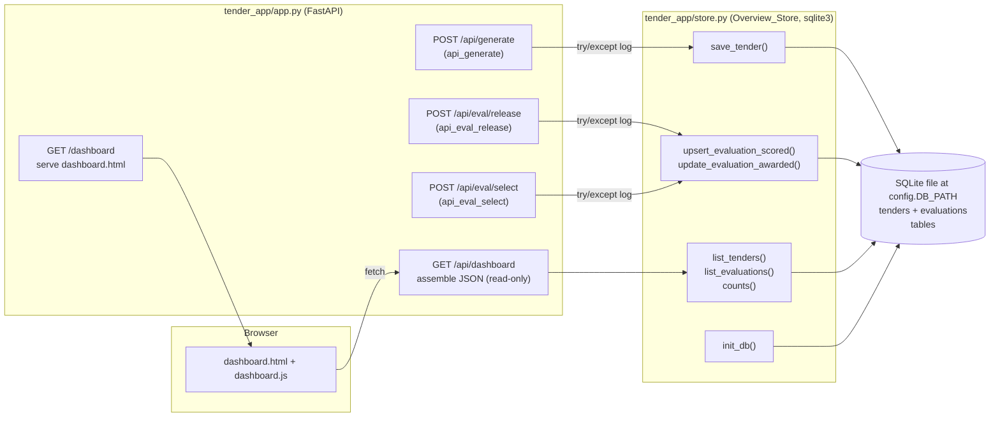

# Design Document: Persistent Overview Dashboard

## Overview

This feature adds a **persistent overview Dashboard** to the existing AI-Powered Tender Document Builder (Python + FastAPI + server-rendered HTML + vanilla JS). Unlike the live workflow pages (`/` tender builder, `/evaluation` bid evaluation), the Dashboard is a durable overview: it lists **every tender that has been generated** and **every bid evaluation that has been scored or awarded**, read from a small local database that survives process restarts.

Today the app keeps a single session in an in-memory `STATE` dict (`tender_app/app.py`) that resets on restart, so nothing persists across sessions. This design introduces a thin persistence layer — the **Overview_Store** — built on the Python standard library `sqlite3` module writing to one local database file. No ORM, no new runtime dependency.

Records are written at the two natural completion points in the existing flows, and read back only by the Dashboard:

- A **Tender_Record** is inserted when `POST /api/generate` (`api_generate`) successfully produces the PDF and/or BOQ.
- An **Evaluation_Record** is upserted (keyed by `run_id`) when `POST /api/eval/release` (`api_eval_release`) scores a run (status `scored`), and updated to status `awarded` when `POST /api/eval/select` (`api_eval_select`) records a final selection.

Drafts and in-progress work are not persisted. Reading the Dashboard never mutates records. Crucially, a persistence failure must never break tender generation or evaluation: the store **raises** on real DB errors, and each integration caller **wraps the call in try/except, logs, and continues** (graceful degradation). The existing per-run audit JSON written to `config.EVAL_DIR` by `audit.persist_run` is retained unchanged; the new evaluation row is a lightweight summary/index that links back to that audit record via `GET /api/eval/audit/{run_id}`, not a replacement for it.

The Dashboard is served at `GET /dashboard` (routing Option A: `GET /` remains the tender builder, `GET /evaluation` is unchanged, and the sidebar "Dashboard" link is repointed from `/` to `/dashboard`). It reuses the existing shared left sidebar and visual style (navy `#1F3864`, orange `#e07b00`, green `#1a7a46`, white cards; `.card` / `.tile` / `.tiles` / `.pill` / `.badge` classes) and introduces no frontend framework.

### Alignment with existing code

- **`tender_app/config.py`** defines `OUTPUT_DIR` and `EVAL_DIR` as `Path` values, each followed by `.mkdir(...)`. We add `DB_PATH` in the same style.
- **`tender_app/app.py`** holds one module-level `STATE` dict and serves pages with `(APP_DIR / "templates" / x).read_text(encoding="utf-8")`. The three write points already exist:
  - `api_generate` builds `boq_name` / `pdf_name` and returns `boq_url = /download/{boq_name}` and `pdf_url = /download/{pdf_name}` (on a per-kind success basis; either may fail independently).
  - `api_eval_release` calls `pipeline.release_and_score(run)` then `audit.persist_run(run)` and sets `STATE["run_id"]`.
  - `api_eval_select` builds a `FinalSelection(bid_id=...)`, calls `audit.append_action(run, selection)`, and persists.
- **`TenderBrief`** (`tender_app/models.py`) exposes `name_of_work`, `tender_reference_no`, `tender_inviting_authority`, `emd_amount`, and `completeness() -> int` (0–100).
- **`EvaluationRun`** (`tender_app/evaluation/models.py`) exposes `run_id`, `created_at`, `tender` (a `TenderBrief`), `bids` (list), `evaluations` (list of `BidEvaluation`, each with `completeness.complete: bool`), `shortlist` (`entries` of `ShortlistEntry` with `bid_id` / `bidder_name` / `rank` / `eligible` / `price`; `best_match_bid_id: Optional[str]`; `none_eligible: bool`), and `final_selection: Optional[FinalSelection]` (with `bid_id`).
- **UI**: `templates/index.html` and `templates/evaluation.html` share a `nav.sidebar` inside `.app-shell` + `.app-content`. The first nav item is currently `<li><a href="/">Dashboard</a></li>`; this href is repointed to `/dashboard`.
- **CSS** (`static/style.css`) already defines `.tiles` (4-col grid), `.tile` (`.tile-val`, `.tile-label`), `.card`, `.pill`, and `.badge` (with `.present/.satisfied/.yes` green, `.missing/.no` red, `.unreadable/.partly` amber, `.none` grey). We reuse these and append only small table styles.

## Architecture

The feature adds one persistence module and two routes, and wires three existing write points.



Key boundaries:

- **The store raises; callers swallow.** All `store.py` functions perform plain `sqlite3` work and let exceptions propagate. The three write-point callers in `app.py` each wrap their single store call in `try/except Exception` that logs and continues, so generation/evaluation responses are never affected by a DB fault (Req 6).
- **Short-lived connections per call.** Each store function opens its own `sqlite3.connect(config.DB_PATH)`, does its work in a `with conn:` transaction, and closes. See *Connection strategy* below for the justification.
- **Writes only at the three integration points.** `GET /dashboard` and `GET /api/dashboard` call only read functions (`list_tenders`, `list_evaluations`, `counts`) and never write (Req 11.4, 11.5).
- **Startup init.** `store.init_db()` is called once at `app.py` import time (after `STATE` is defined), wrapped in try/except so a failing init cannot stop the app from booting (Req 1.3, 6).

Request flow for the Dashboard:

1. Officer clicks **Dashboard** in the sidebar → `GET /dashboard`.
2. `GET /dashboard` returns `templates/dashboard.html` (static shell).
3. `dashboard.js` calls `GET /api/dashboard`.
4. `api_dashboard` reads the store (`counts`, `list_tenders`, `list_evaluations`), computes `empty`, returns JSON.
5. `dashboard.js` renders the four tiles, the Tenders table, the Evaluations table, and toggles the empty-state block.

## Components and Interfaces

### 1. New module: `tender_app/store.py` (the Overview_Store)

Uses stdlib `sqlite3` only. Imports `config` for `DB_PATH` and the `logging` module for failure logging.

#### Connection strategy (decision + justification)

**Decision: short-lived connections opened per operation**, each with `row_factory = sqlite3.Row`.

```python
import sqlite3
from . import config

def _connect() -> sqlite3.Connection:
    conn = sqlite3.connect(config.DB_PATH)
    conn.row_factory = sqlite3.Row
    return conn
```

Justification: FastAPI under uvicorn serves requests on a worker thread pool, and a single `sqlite3.Connection` object is **not safe to share across threads** unless opened with `check_same_thread=False` plus the caller's own locking. A per-call connection sidesteps that entirely: each operation gets a fresh connection confined to the calling thread, used inside a `with conn:` block (which commits on success / rolls back on exception) and closed in a `finally`. The workload is tiny (a few rows per write, a handful of reads on page load), so the per-call `connect()` cost is negligible and buys simplicity and thread-safety. A module-level `check_same_thread=False` connection with manual locking was considered and rejected as unnecessary complexity for this scale.

#### `init_db() -> None`

Ensures the parent directory exists (defensive; `config.py` also does this at import) then creates both tables if absent. Called once at startup.

```python
def init_db() -> None:
    config.DB_PATH.parent.mkdir(parents=True, exist_ok=True)
    with _connect() as conn:
        conn.execute(
            """
            CREATE TABLE IF NOT EXISTS tenders (
                id                 INTEGER PRIMARY KEY AUTOINCREMENT,
                name_of_work       TEXT,
                tender_reference_no TEXT,
                inviting_authority TEXT,
                emd_amount         TEXT,
                completeness       INTEGER,
                generated_at       TEXT,
                pdf_filename       TEXT,
                pdf_url            TEXT,
                boq_filename       TEXT,
                boq_url            TEXT
            )
            """
        )
        conn.execute(
            """
            CREATE TABLE IF NOT EXISTS evaluations (
                id                     INTEGER PRIMARY KEY AUTOINCREMENT,
                run_id                 TEXT UNIQUE,
                tender_reference_no    TEXT,
                bidders_count          INTEGER,
                complete_bids_count    INTEGER,
                best_match_bidder_id   TEXT,
                best_match_bidder_name TEXT,
                none_eligible          INTEGER,
                final_selection_bidder TEXT,
                released_at            TEXT,
                status                 TEXT
            )
            """
        )
```

The `run_id TEXT UNIQUE` constraint is what makes evaluation writes idempotent via SQLite upsert (Req 5.3).

Satisfies Req 1.1, 1.2, 1.3, 1.4, 1.5, 1.6.

#### `save_tender(record: dict) -> int`

Inserts exactly one row per generation event and returns the new `id` (`cursor.lastrowid`). One row per call means regenerating the same `tender_reference_no` yields a new row; ordering by `generated_at DESC` then surfaces the newest first (Req 3.8, 5.4). Missing/empty keys are stored as empty strings, never rejected (Req 3.7).

```python
def save_tender(record: dict) -> int:
    with _connect() as conn:
        cur = conn.execute(
            """
            INSERT INTO tenders (
                name_of_work, tender_reference_no, inviting_authority, emd_amount,
                completeness, generated_at, pdf_filename, pdf_url, boq_filename, boq_url
            ) VALUES (?, ?, ?, ?, ?, ?, ?, ?, ?, ?)
            """,
            (
                record.get("name_of_work", ""),
                record.get("tender_reference_no", ""),
                record.get("inviting_authority", ""),
                record.get("emd_amount", ""),
                int(record.get("completeness", 0) or 0),
                record.get("generated_at", ""),
                record.get("pdf_filename", ""),
                record.get("pdf_url", ""),
                record.get("boq_filename", ""),
                record.get("boq_url", ""),
            ),
        )
        return int(cur.lastrowid)
```

Satisfies Req 3.1–3.8.

#### `upsert_evaluation_scored(run) -> None`

Writes/updates the Evaluation_Record for a scored run, keyed by `run_id` via SQLite's `INSERT ... ON CONFLICT(run_id) DO UPDATE`. On conflict it updates the summary fields and sets `status = 'scored'`, but **preserves `final_selection_bidder`** so a re-release after an award does not blank the awarded bidder. It derives counts and best-match from the run.

```python
def upsert_evaluation_scored(run) -> None:
    bidders_count = len(run.bids)
    complete_bids = sum(1 for ev in run.evaluations if ev.completeness.complete)
    best_id, best_name = None, None
    sl = run.shortlist
    if sl.best_match_bid_id:
        match = next((e for e in sl.entries if e.bid_id == sl.best_match_bid_id), None)
        best_id = sl.best_match_bid_id
        best_name = match.bidder_name if match else ""
    released_at = run.created_at or _now_iso()
    with _connect() as conn:
        conn.execute(
            """
            INSERT INTO evaluations (
                run_id, tender_reference_no, bidders_count, complete_bids_count,
                best_match_bidder_id, best_match_bidder_name, none_eligible,
                released_at, status
            ) VALUES (?, ?, ?, ?, ?, ?, ?, ?, 'scored')
            ON CONFLICT(run_id) DO UPDATE SET
                tender_reference_no    = excluded.tender_reference_no,
                bidders_count          = excluded.bidders_count,
                complete_bids_count    = excluded.complete_bids_count,
                best_match_bidder_id   = excluded.best_match_bidder_id,
                best_match_bidder_name = excluded.best_match_bidder_name,
                none_eligible          = excluded.none_eligible,
                released_at            = excluded.released_at,
                status                 = 'scored'
            """,
            (
                run.run_id,
                run.tender.tender_reference_no,
                bidders_count,
                complete_bids,
                best_id,
                best_name,
                1 if sl.none_eligible else 0,
                released_at,
            ),
        )
```

Satisfies Req 4.1–4.6, 5.1, 5.3.

#### `update_evaluation_awarded(run_id: str, bidder: str) -> None`

Records a final selection: update the existing row's `final_selection_bidder` and set `status = 'awarded'`; if no row exists yet, insert one with status `'awarded'` (Req 4.8). Same `ON CONFLICT(run_id)` upsert keyed by `run_id` guarantees no duplicate (Req 5.2, 5.3).

```python
def update_evaluation_awarded(run_id: str, bidder: str) -> None:
    with _connect() as conn:
        conn.execute(
            """
            INSERT INTO evaluations (run_id, final_selection_bidder, status)
            VALUES (?, ?, 'awarded')
            ON CONFLICT(run_id) DO UPDATE SET
                final_selection_bidder = excluded.final_selection_bidder,
                status                 = 'awarded'
            """,
            (run_id, bidder or ""),
        )
```

Satisfies Req 4.7, 4.8, 5.2, 5.3.

#### Read functions

```python
def list_tenders() -> list[dict]:
    with _connect() as conn:
        rows = conn.execute(
            "SELECT * FROM tenders ORDER BY generated_at DESC, id DESC"
        ).fetchall()
    return [dict(r) for r in rows]

def list_evaluations() -> list[dict]:
    with _connect() as conn:
        rows = conn.execute(
            "SELECT * FROM evaluations ORDER BY released_at DESC, id DESC"
        ).fetchall()
    return [dict(r) for r in rows]

def counts() -> dict:
    with _connect() as conn:
        total_tenders = conn.execute("SELECT COUNT(*) FROM tenders").fetchone()[0]
        total_evaluations = conn.execute("SELECT COUNT(*) FROM evaluations").fetchone()[0]
        awarded = conn.execute(
            "SELECT COUNT(*) FROM evaluations WHERE status = 'awarded'"
        ).fetchone()[0]
        scored = conn.execute(
            "SELECT COUNT(*) FROM evaluations WHERE status = 'scored'"
        ).fetchone()[0]
    return {
        "total_tenders": total_tenders,
        "total_evaluations": total_evaluations,
        "awarded": awarded,
        "scored": scored,
    }
```

The secondary `id DESC` tiebreaker keeps ordering stable when two rows share a timestamp. `list_tenders` newest-first satisfies Req 9.5, 11.3; `list_evaluations` newest-first satisfies Req 10.5, 11.3; `counts` satisfies Req 8.1–8.5.

A tiny `_now_iso()` helper (`datetime.now().isoformat(timespec="seconds")`) provides the fallback timestamp. All write functions raise on real `sqlite3.Error`; swallowing is the caller's job (documented below).

### 2. `tender_app/config.py` addition

Add `DB_PATH` after `EVAL_DIR`, matching the existing `Path` + `mkdir` style. The default lives under the package directory (Req 2.1–2.3):

```python
# SQLite database file for the persistent Dashboard overview (tenders + evaluations).
DB_PATH = Path(__file__).resolve().parent / "data" / "app.db"
DB_PATH.parent.mkdir(parents=True, exist_ok=True)
```

`DB_PATH.parent.mkdir(..., exist_ok=True)` guarantees the `data/` directory exists before any connection (Req 1.4). `store.init_db()` is invoked at `app.py` import time (see below), reading `config.DB_PATH`, so an environment-overridden value would be picked up the same way (Req 2.2, 2.3).

### 3. `tender_app/app.py` integration (minimal additions, not rewrites)

**a) Startup init — after the `STATE` dict definition:**

```python
from . import store

try:
    store.init_db()
except Exception as exc:  # noqa: BLE001 — a DB init fault must not stop boot.
    logging.getLogger(__name__).warning("Dashboard store init failed: %s", exc)
```

**b) In `api_generate`, success path — just before `return JSONResponse(result)`:** write a tender record built from `STATE["brief"]` plus the generated filenames/urls. It runs whenever a PDF **or** BOQ was produced (Req 3.1); keys for a kind that failed are left empty (Req 3.5–3.7).

```python
if "pdf_url" in result or "boq_url" in result:
    try:
        store.save_tender({
            "name_of_work": brief.name_of_work,
            "tender_reference_no": brief.tender_reference_no,
            "inviting_authority": brief.tender_inviting_authority,
            "emd_amount": brief.emd_amount,
            "completeness": brief.completeness(),
            "generated_at": datetime.now().isoformat(timespec="seconds"),
            "pdf_filename": pdf_name if "pdf_url" in result else "",
            "pdf_url": result.get("pdf_url", ""),
            "boq_filename": boq_name if "boq_url" in result else "",
            "boq_url": result.get("boq_url", ""),
        })
    except Exception as exc:  # noqa: BLE001 — persistence must never break generate.
        logging.getLogger(__name__).warning("save_tender failed: %s", exc)
```

**c) In `api_eval_release`, after `pipeline.release_and_score` + `audit.persist_run`:**

```python
try:
    store.upsert_evaluation_scored(run)
except Exception as exc:  # noqa: BLE001
    logging.getLogger(__name__).warning("upsert_evaluation_scored failed: %s", exc)
```

**d) In `api_eval_select`, after `audit.append_action(run, selection)`:** resolve the bidder name from the shortlist entry matching `run.final_selection.bid_id` (fall back to the bid id), then update to awarded.

```python
sel_bid_id = run.final_selection.bid_id if run.final_selection else payload.bid_id
match = next((e for e in run.shortlist.entries if e.bid_id == sel_bid_id), None)
bidder = (match.bidder_name if match else "") or sel_bid_id
try:
    store.update_evaluation_awarded(run.run_id, bidder)
except Exception as exc:  # noqa: BLE001
    logging.getLogger(__name__).warning("update_evaluation_awarded failed: %s", exc)
```

None of these change the existing success responses when persistence succeeds (Req 6.4).

### 4. New routes in `app.py`

**`GET /dashboard`** — serve the shell exactly like `index()`:

```python
@app.get("/dashboard", response_class=HTMLResponse)
def dashboard_page() -> str:
    return (APP_DIR / "templates" / "dashboard.html").read_text(encoding="utf-8")
```

Satisfies Req 7.1, 7.5.

**`GET /api/dashboard`** — read-only assembly from the store:

```python
@app.get("/api/dashboard")
def api_dashboard() -> JSONResponse:
    try:
        tiles = store.counts()
        tenders = store.list_tenders()
        evaluations = store.list_evaluations()
    except Exception as exc:  # noqa: BLE001 — degrade to an empty dashboard.
        logging.getLogger(__name__).warning("dashboard read failed: %s", exc)
        tiles = {"total_tenders": 0, "total_evaluations": 0, "awarded": 0, "scored": 0}
        tenders, evaluations = [], []
    return JSONResponse({
        "tiles": tiles,
        "tenders": tenders,
        "evaluations": evaluations,
        "empty": not tenders and not evaluations,
    })
```

Read-only, writes nothing (Req 11.1, 11.2, 11.4, 11.5). `empty` drives the empty state (Req 12.1).

### 5. New template: `tender_app/templates/dashboard.html`

Reuses the `.app-shell` + `nav.sidebar` + `.app-content` wrapper copied from `evaluation.html`, with the **Dashboard** nav link `class="active"` and `href="/dashboard"`. The content is a static shell; `dashboard.js` fills it in.

```
.app-shell
  nav.sidebar          (shared markup; Dashboard link active, href="/dashboard")
  .app-content
    header.topbar       (brand "Dashboard", sub "Overview of tenders & evaluations")
    main.dashboard
      .tiles            (4 .tile — Req 8)
        #tile-total-tenders       (tile-val + "Tenders generated")
        #tile-total-evaluations   (tile-val + "Evaluations")
        #tile-awarded             (tile-val + "Awarded")
        #tile-scored              (tile-val + "Scored")

      #content (hidden while empty-state shown)
        .card  "Tenders"  (Req 9)
          table.dash-table#tenders-table
            thead: Name of work | Reference | Authority | Generated | Completeness | Files
            tbody#tenders-body   (one row per Tender_Record; PDF/BOQ links from stored urls)
        .card  "Evaluations"  (Req 10)
          table.dash-table#evaluations-table
            thead: Tender ref | Released | Bidders | Complete | Best match | Status | Final selection | Details
            tbody#evaluations-body  (one row per Evaluation_Record; status badge; audit link)

      #empty-state (hidden by default; shown when summary.empty)  (Req 12)
        guidance "No tenders or evaluations yet. Start by creating a tender."
        a.btn href="/"  "Create a tender"

  script src="/static/dashboard.js"
```

Rendering rules handled in JS:
- Tiles always render from `summary.tiles` (zero when empty — Req 8.6).
- When `summary.empty` is true → show `#empty-state`, hide `#content`.
- When false → hide `#empty-state`, show `#content`, populate both tables.

### 6. New static JS: `tender_app/static/dashboard.js` (vanilla)

```
on DOMContentLoaded:
  fetch("/api/dashboard") -> json summary
  renderTiles(summary.tiles)            // total_tenders, total_evaluations, awarded, scored
  renderTenders(summary.tenders)        // Req 9: name_of_work, reference, authority, generated_at, completeness, PDF/BOQ links
  renderEvaluations(summary.evaluations)// Req 10: ref, released_at, bidders, complete, best match, status badge, final selection, audit link
  toggleEmpty(summary.empty)            // Req 12
  on fetch error: show a small inline message; leave empty-state hidden
```

Rendering specifics:
- **Tenders rows (Req 9.2–9.4):** show `name_of_work`, `tender_reference_no`, `inviting_authority`, the date portion of `generated_at`, `completeness` (reuse `.pill`, e.g. `75%`). If `pdf_url` is non-empty render `<a href="{pdf_url}">PDF</a>`; if `boq_url` is non-empty render `<a href="{boq_url}">BOQ</a>`. These stored urls are the existing `/download/{name}` links.
- **Evaluations rows (Req 10.2–10.4):** show `tender_reference_no`, date portion of `released_at`, `bidders_count`, `complete_bids_count`, `best_match_bidder_name` (or `—`), a status `.badge` (`awarded` → green `.yes`, `scored` → amber `.partly`), `final_selection_bidder` (or `—`), and a **Details** link to `/api/eval/audit/{run_id}` when `run_id` is present. When `none_eligible` is truthy, annotate the best-match cell as "No eligible bid" (Req 10.4).
- All values are escaped before insertion (simple `textContent` / escaping helper) to avoid HTML injection from stored strings.
- Read-only: nothing is posted back (Req 11.4).

### 7. Sidebar link update (two existing pages)

Change the Dashboard nav link from `/` to `/dashboard` in both shared sidebars:

- `tender_app/templates/index.html`: `<li><a href="/">Dashboard</a></li>` → `<li><a href="/dashboard">Dashboard</a></li>`.
- `tender_app/templates/evaluation.html`: same change.
- `tender_app/templates/dashboard.html`: Dashboard link uses `href="/dashboard"` and `class="active"`.

Only the Dashboard link changes; all other nav links stay as-is. Satisfies Req 7.4.

### 8. CSS additions (`tender_app/static/style.css`)

Append a small block for the two dashboard tables; reuse `.card`, `.tiles`, `.tile`, `.pill`, `.badge` as-is.

```css
/* Dashboard tables */
.dash-table { width: 100%; border-collapse: collapse; font-size: 13px; }
.dash-table th, .dash-table td { text-align: left; padding: 8px 10px; border-bottom: 1px solid #e2e7ef; }
.dash-table th { color: #64748b; font-weight: 600; }
.dash-empty { text-align: center; padding: 40px; color: #64748b; }
```

## Data Models

No new pydantic/domain models. Persistence is two SQLite tables; the API returns plain dicts (via `sqlite3.Row` → `dict`).

### `tenders` table (Req 1.5)

| Column | Type | Source | Requirement |
|--------|------|--------|-------------|
| `id` | INTEGER PK AUTOINCREMENT | auto | 1.5 |
| `name_of_work` | TEXT | `brief.name_of_work` | 3.2 |
| `tender_reference_no` | TEXT | `brief.tender_reference_no` | 3.2 |
| `inviting_authority` | TEXT | `brief.tender_inviting_authority` | 3.2 |
| `emd_amount` | TEXT | `brief.emd_amount` | 3.2 |
| `completeness` | INTEGER | `brief.completeness()` | 3.3 |
| `generated_at` | TEXT (ISO) | time of generation | 3.4 |
| `pdf_filename` | TEXT | `pdf_name` when PDF produced | 3.5 |
| `pdf_url` | TEXT | `result["pdf_url"]` (`/download/{pdf_name}`) | 3.5 |
| `boq_filename` | TEXT | `boq_name` when BOQ produced | 3.6 |
| `boq_url` | TEXT | `result["boq_url"]` (`/download/{boq_name}`) | 3.6 |

### `evaluations` table (Req 1.6)

| Column | Type | Source | Requirement |
|--------|------|--------|-------------|
| `id` | INTEGER PK AUTOINCREMENT | auto | 1.6 |
| `run_id` | TEXT UNIQUE | `run.run_id` | 4.2, 5.3 |
| `tender_reference_no` | TEXT | `run.tender.tender_reference_no` | 4.2 |
| `bidders_count` | INTEGER | `len(run.bids)` | 4.3 |
| `complete_bids_count` | INTEGER | count of `evaluations` with `completeness.complete` | 4.3 |
| `best_match_bidder_id` | TEXT | `shortlist.best_match_bid_id` | 4.4 |
| `best_match_bidder_name` | TEXT | matched entry's `bidder_name` | 4.4 |
| `none_eligible` | INTEGER (0/1) | `shortlist.none_eligible` | 4.5 |
| `final_selection_bidder` | TEXT | selected bidder name (set on award) | 4.7 |
| `released_at` | TEXT (ISO) | `run.created_at` or time of release | 4.6 |
| `status` | TEXT | `'scored'` on release, `'awarded'` on select | 4.1, 4.7 |

### `GET /api/dashboard` JSON shape

```json
{
  "tiles": {
    "total_tenders": 0,
    "total_evaluations": 0,
    "awarded": 0,
    "scored": 0
  },
  "tenders": [
    {
      "id": 1,
      "name_of_work": "",
      "tender_reference_no": "",
      "inviting_authority": "",
      "emd_amount": "",
      "completeness": 0,
      "generated_at": "",
      "pdf_filename": "",
      "pdf_url": "",
      "boq_filename": "",
      "boq_url": ""
    }
  ],
  "evaluations": [
    {
      "id": 1,
      "run_id": "",
      "tender_reference_no": "",
      "bidders_count": 0,
      "complete_bids_count": 0,
      "best_match_bidder_id": "",
      "best_match_bidder_name": "",
      "none_eligible": 0,
      "final_selection_bidder": "",
      "released_at": "",
      "status": "scored"
    }
  ],
  "empty": true
}
```

`tenders` is ordered newest `generated_at` first; `evaluations` newest `released_at` first (Req 11.3). `empty` is `true` only when both lists are empty (Req 12.1).

## Correctness Properties

*A property is a characteristic or behavior that should hold true across all valid executions of a system — essentially, a formal statement about what the system should do. Properties serve as the bridge between human-readable specifications and machine-verifiable correctness guarantees.*

Most of this feature's acceptance criteria are deterministic field mappings (brief/run → table columns), aggregate counts, list ordering, route serving, and UI rendering — all best covered by example/integration tests against the store and the two routes (see Testing Strategy). Property-based testing is **largely not warranted** here (persistence/CRUD + view assembly). The one genuinely universal property worth asserting is the **idempotence of evaluation writes keyed by `run_id`**: it must hold for *any* sequence of release/select operations, and random sequences can reveal interleavings a couple of hand-written examples would miss.

### Property 1: Evaluation upsert keyed by `run_id` never duplicates

*For any* non-empty sequence of evaluation write operations applied to a single `run_id` — each operation being either a scored release (`upsert_evaluation_scored`) or an awarded selection (`update_evaluation_awarded`), in any order and any count — the `evaluations` table SHALL contain exactly **one** row for that `run_id` after the whole sequence, and that row's `status` SHALL be `'awarded'` if the sequence contains at least one awarded selection, otherwise `'scored'`.

**Validates: Requirements 5.1, 5.2, 5.3**

(Generation note: generate a fixed `run_id` and a random list of 1–N operation tags drawn from `{"scored", "awarded"}`; apply each against a fresh temp/in-memory store; after the sequence assert `SELECT COUNT(*) FROM evaluations WHERE run_id = ?` equals 1 and the status matches the "awarded if any awarded else scored" rule. A lightweight hand-built `EvaluationRun` stand-in supplies the fields `upsert_evaluation_scored` reads.)

## Error Handling

The division of responsibility is explicit: **the store raises, the callers swallow.**

- **Store layer (`store.py`):** every function performs plain `sqlite3` work inside `with _connect() as conn:` and lets `sqlite3.Error` (and any other exception) propagate. The store does not try to hide failures — that keeps it simple and testable (Req 6.3 logging happens at the caller, but the store may additionally log).
- **Write-point callers (`api_generate`, `api_eval_release`, `api_eval_select`):** each wraps its single `store.*` call in `try/except Exception` that logs via `logging.getLogger(__name__).warning(...)` and continues. Therefore a DB fault never changes the HTTP response the Officer sees: generation still returns its `boq_url`/`pdf_url` (or per-kind errors), release still returns the matrix payload, select still returns its confirmation (Req 6.1, 6.2, 6.4).
- **Startup init:** `store.init_db()` at import time is wrapped in try/except that logs; a failing init cannot stop the app from booting. The Dashboard then degrades to an empty/zeroed view (Req 1.3, 6).
- **Read path (`api_dashboard`):** the read calls are wrapped in try/except that logs and falls back to zeroed tiles + empty lists, so a corrupt/locked DB yields an empty Dashboard rather than a 500 (Req 11.1, graceful degradation).
- **Empty / missing fields:** `save_tender` reads `record.get(key, "")`, so an empty or absent brief field is stored as an empty string and never rejected (Req 3.7). `upsert_evaluation_scored` tolerates an empty shortlist (`best_match_bid_id` falsy → best-match columns stay `NULL`).
- **Best-match name resolution:** if `best_match_bid_id` is set but no matching shortlist entry is found, the stored `best_match_bidder_name` is an empty string rather than raising.
- **Path safety:** `DB_PATH` is a fixed configured path under the package `data/` directory; it is never built from request input, so there is no path-traversal surface (unlike the download/eval-document routes which already guard with `.resolve()` checks).

## Testing Strategy

This is persistence + read-only view assembly, so the strategy is a small set of example/integration tests over the store and the two routes, plus one light property test for the upsert idempotence invariant. Tests use a **temporary database** so the real `tender_app/data/app.db` is never touched, and FastAPI's `TestClient` (already used in the repo).

### Test database isolation

Point the store at a throwaway DB per test via `monkeypatch`:

- Set `config.DB_PATH` to a `tmp_path / "test.db"` (pytest `tmp_path` fixture), then call `store.init_db()`; **or**
- Use an in-memory DB (`:memory:`) with a shared connection for the pure store/property tests.

Because every store function reads `config.DB_PATH` at call time via `_connect()`, monkeypatching `config.DB_PATH` is sufficient to redirect all writes/reads. A fixture creates a fresh temp DB and runs `init_db()` before each test.

### Example / integration tests (primary)

1. **Init creates tables.** `init_db()` on a temp DB → querying `sqlite_master` shows `tenders` and `evaluations`; columns match the schema. Validates Req 1.3, 1.5, 1.6.

2. **save_tender then list_tenders, newest first.** Insert three tender records with increasing `generated_at`; `list_tenders()` returns 3 rows, newest first, echoing the stored fields; a record with empty fields is stored as empty strings. Validates Req 3.1–3.8, 5.4, 9.5, 11.3.

3. **upsert_evaluation_scored maps fields + status scored.** Build a minimal `EvaluationRun` (two `bids`, some `evaluations` with `completeness.complete`, a `shortlist` with a `best_match_bid_id` and an entry); call `upsert_evaluation_scored(run)`; assert the row has correct `bidders_count`, `complete_bids_count`, `best_match_bidder_name`, `none_eligible`, `released_at`, and `status == 'scored'`. Validates Req 4.1–4.6.

4. **Release then select updates in place to awarded (no duplicate).** `upsert_evaluation_scored(run)` then `update_evaluation_awarded(run.run_id, "ACME")`; assert exactly one row for that `run_id`, `status == 'awarded'`, `final_selection_bidder == "ACME"`, and the scored summary fields are preserved. Validates Req 4.7, 5.1, 5.2.

5. **Select with no prior row inserts awarded.** `update_evaluation_awarded("run-x", "ACME")` on an empty table → one row, `status == 'awarded'`. Validates Req 4.8.

6. **counts() aggregates correctly.** Seed known tenders + a mix of scored/awarded evaluations; assert `counts()` returns the right `total_tenders`, `total_evaluations`, `awarded`, `scored`; empty DB → all zero. Validates Req 8.1–8.6.

7. **GET /api/dashboard shape, ordering, and no-mutation.** Seed rows; `GET /api/dashboard` returns `tiles` + `tenders` (newest `generated_at` first) + `evaluations` (newest `released_at` first) + `empty == false`; row counts before and after the call are identical. Empty DB → `empty == true` and zeroed tiles. Validates Req 10.5, 11.1–11.5, 12.1.

8. **Routes served + sidebar link.** `GET /dashboard` → 200 HTML containing the sidebar and an active Dashboard link to `/dashboard`; `GET /` and `GET /evaluation` still return their existing pages. Validates Req 7.1–7.5.

9. **Graceful degradation.** Monkeypatch `store.save_tender` to raise; `POST /api/generate` still returns a success result (no 500, `pdf_url`/`boq_url` present). Repeat the idea for `upsert_evaluation_scored` on release and `update_evaluation_awarded` on select. Validates Req 6.1, 6.2, 6.4.

### Property test (light, single)

A single property-based test for **Property 1** using **Hypothesis** (already present in the repo — a `.hypothesis` cache exists in the workspace). It generates an arbitrary non-empty list of operation tags from `{"scored", "awarded"}` for a fixed `run_id`, applies them to a fresh temp store, and asserts exactly one row exists for that `run_id` and the status matches the "awarded if any awarded else scored" rule.

- Minimum 100 iterations.
- Tagged: **Feature: dashboard-landing, Property 1: Evaluation upsert keyed by run_id never duplicates**.

### Why PBT is limited here

Per the testing guidance, PBT is not appropriate for simple CRUD, aggregate counts, route serving, or UI rendering. Requirements 1, 2, 3.x, 4.x (mapping), 6.x, 7.x, 8.x, 9.x, 10.x, 11.x, and 12.x are deterministic mappings or single-branch behaviors covered by the example/integration tests above. Only the `run_id` idempotence invariant generalizes over a large input space (arbitrary operation sequences), so it is the sole property. The `dashboard.js` rendering and sidebar visuals are verified by the HTML/route tests and manual review.
